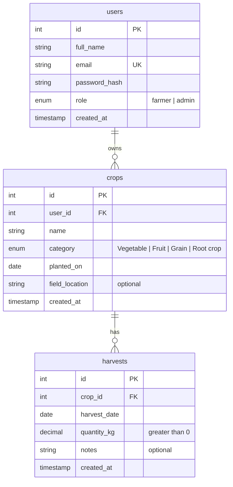

# AgriTrack: Harvest Logbook · ERD (draft for backend pair approval)

## Rules
- A farmer sees and creates only their own crops and harvests. Admin sees everything, read-only.
- `crops.planted_on` and `harvests.harvest_date` cannot be in the future; a harvest cannot be dated before its crop's `planted_on`.
- `quantity_kg` must be greater than 0. `crops.name` has at least 2 characters.
- 3NF: a harvest's owner is found through its crop, so there is no `user_id` on `harvests`. `crop_name` and `owner_name` in API responses are joined, not stored.

## Open questions for the backend pair
1. Deleting a crop: cascade to its harvests, or block the delete?
2. How are farmer accounts created (seeded, or added by admin)? The frontend has no sign-up screen.
3. Keep `category` as a fixed list, or make it its own table?
